# 🚀 Awesome Database Stored Procedures 

  

  
  
  
  
  
  

  <strong>🌟 A Curated Index of High-Performance Procedural SQL Engines, Managed Cloud Platforms, Server-Side Logic Runtimes &amp; Database Architecture Resources. 🌟</strong>

  <em>Covering PL/pgSQL, PL/SQL, T-SQL, SQL/PSM, Distributed HTAP, Cloud RDBMS &amp; High-Throughput In-Memory Engines</em>

---

## 📑 Table of Contents

- [🔍 Sector Overview &amp; Market Dynamics](#-sector-overview--market-dynamics)
- [☁️ SaaS / Managed Cloud Database Platforms](#️-saas--managed-cloud-database-platforms)
- [🛠️ Open-Source Database Engines (Ranked by Stars)](#️-open-source-database-engines-ranked-by-stars)
  - [1. TiDB](#1-tidb)
  - [2. CockroachDB](#2-cockroachdb)
  - [3. PostgreSQL](#3-postgresql)
  - [4. Citus Data](#4-citus-data)
  - [5. MySQL](#5-mysql)
  - [6. YugabyteDB](#6-yugabytedb)
  - [7. MariaDB Server](#7-mariadb-server)
  - [8. H2 Database Engine](#8-h2-database-engine)
  - [9. OrioleDB](#9-orioledb)
  - [10. Firebird RDBMS](#10-firebird-rdbms)
- [💡 Architectural Comparison &amp; Dialect Cheatsheet](#-architectural-comparison--dialect-cheatsheet)
- [🤝 How to Contribute](#-how-to-contribute)
- [💖 Support &amp; Sponsorship](#-support--sponsorship)
- [📈 Star History](#-star-history)
- [⚖️ Disclaimer](#️-disclaimer)

---

## 🔍 Sector Overview &amp; Market Dynamics

The global **Database Management Systems (DBMS)** and **Cloud Database Platform** market is estimated at **$111B to $135B in 2025** and projected to surpass **$160B by 2026**, expanding at a compound annual growth rate (CAGR) of 11–13%. 

The competitive landscape is **moderately concentrated among hyperscale cloud providers and enterprise software powerhouses** (Microsoft Azure, Google Cloud, AWS, Oracle, IBM, SAP), who command the dominant share of mission-critical transactional and analytical workloads. Concurrently, high-speed transactional needs and modern microservice architectures maintain specialized fragmentation, driving rapid adoption of open-source distributed SQL engines, pluggable transactional storage engines, and PostgreSQL-compatible procedural platforms.

---

## ☁️ SaaS / Managed Cloud Database Platforms

| 🏢 Platform | 💰 Company Valuation / Market Cap | 🏷️ Pricing (Starting Tier) | 🎁 Free Tier Limits | ⚡ Key Highlights &amp; Trade-offs |
| :--- | :--- | :--- | :--- | :--- |
| **[Microsoft SQL Server / Azure SQL](https://www.microsoft.com/sql-server)** | ~$3.1 Trillion *(Market Cap)* | $0.007/hr (~$5.00/mo) for DTU Basic; or $0.52/vCore-hour serverless ($15,123/core for Enterprise on-prem) | **Perpetual Free Tier**: 100,000 vCore seconds/month, 32 GB data storage, and 32 GB backup storage *(or Express edition: 10 GB DB, 4 cores free)* | Mature T-SQL stored procedures with deep Azure ecosystem integration. Industry benchmark for .NET; per-core production licensing scales steeply. |
| **[Google Cloud Spanner](https://cloud.google.com/spanner)** | ~$2.1 Trillion *(Alphabet Market Cap)* | $0.030 per 100 Processing Units (PUs)/hr (~$0.30/node-hr; regional multi-zone ~$1.17/node-hr) | **90-Day Free Trial**: 1 instance with 10 GiB storage, max 5 databases, and standard edition features | Globally distributed database with GoogleSQL &amp; PostgreSQL dialects. Delivers external consistency at global scale; trial instance expires after 90 days. |
| **[PostgreSQL RDS](https://aws.amazon.com/rds/postgresql/)** | ~$2.0 Trillion *(Amazon Market Cap)* | $0.017/hr (~$12.41/mo) for db.t3.micro (Single-AZ) | **AWS Free Tier**: 750 hrs/month of db.t3.micro + 20 GB storage for 12 months *(introductory first year)* | Fully managed PostgreSQL supporting PL/pgSQL and extensions. Eliminates operational maintenance; free tier expires after first 12 months. |
| **[Oracle Cloud Database](https://www.oracle.com/)** | ~$350 Billion *(Market Cap)* | $0.336/ECPU-hr (License Included) or $0.0807/ECPU-hr (BYOL); min 2 ECPUs | **Always Free Tier**: 2 Autonomous Databases (ATP/ADW) each with 20 GB storage and 1 ECPU | Enterprise-grade PL/SQL stored procedures with automated indexing and tuning. Ideal for Oracle enterprise workloads; idle free instances subject to reclamation. |
| **[MySQL HeatWave](https://www.oracle.com/mysql/)** | ~$350 Billion *(Oracle Market Cap)* | $0.0366/ECPU-hr for MySQL DB System + HeatWave node fees (~$0.0194/GB-hr) | **Always Free Tier**: 5,000 hours and 550 GB storage for single HeatWave node instance | MySQL with SQL/PSM and hardware-accelerated in-memory analytics. Generous free tier restricted to single node without high availability. |
| **[SAP HANA Cloud](https://www.sap.com/products/hana.html)** | ~$260 Billion *(Market Cap)* | €0.75 per Capacity Unit (CU)/mo (~€0.0010/CU-hr; compute sized in CUs) | **Free Tier**: 1 instance with 16 GB memory, 80 GB storage, and 1 vCPU *(stops nightly; 30-day trial extendable up to 90 days)* | Column-oriented in-memory database with SQLScript stored procedures. Purpose-built for ERP and SAP environments; premium consumption pricing. |
| **[IBM Db2 on Cloud](https://www.ibm.com/products/db2)** | ~$215 Billion *(Market Cap)* | $99/mo for Standard Plan (includes 2 vCPUs, 8 GB RAM, and initial storage) | **Lite Plan**: Perpetually free with 200 MB data storage and max 5 concurrent connections | Enterprise Db2 engine with SQL PL stored procedures. Lite tier is sandbox-only; production environments require paid Standard or Dedicated tiers. |
| **[Snowflake Stored Procedures](https://www.snowflake.com/)** | ~$55–$75 Billion *(Market Cap)* | $2.00 per credit for Standard Edition (on-demand compute) | **Free Trial Only**: 30-day trial with $400 in usage credits *(no perpetual free tier)* | Server-side procedural logic in JavaScript, Python, Java, and Scala close to analytical data. Multi-language support; compute fees accrue per credit execution. |
| **[CockroachDB](https://www.cockroachlabs.com/)** | ~$5 Billion *(Valuation)* | $0.092–$0.18 per vCPU-hr (Standard tier) or $0.50/GiB additional storage | **Free Tier (Basic / Serverless)**: 50 Million Request Units (RUs) and 10 GiB storage free every month | Distributed SQL with native PL/pgSQL support (v25+). Elastic horizontal scale; commercial self-hosting subject to license restrictions. |
| **[SingleStore Helios](https://www.singlestore.com/)** | ~$1.3 Billion *(Valuation)* | $0.99/hr for Standard Starter Workspace | **Free Starter Workspace**: 1 GB compressed storage (~4 GB uncompressed) on shared infrastructure | Distributed SQL and real-time HTAP analytics with procedural code. Shared free tier workspace intended for evaluation and non-production testing. |

---

## 🛠️ Open-Source Database Engines (Ranked by Stars)

All open-source repositories below are ranked in descending order by GitHub stargazers. Click any star badge to view real-time stargazers.

### 1. TiDB

- **Repository**: [pingcap/tidb](https://github.com/pingcap/tidb) 🌐
- **License**: Apache-2.0 📜
- **Primary Dialect**: MySQL Protocol / SQL/PSM Compatible 🐬
- **Overview**: An open-source distributed Hybrid Transactional and Analytical Processing (HTAP) database built in Go. TiDB speaks the MySQL wire protocol, supporting SQL/PSM stored procedures and triggers while providing horizontal scalability, strong consistency via Raft, and real-time analytics.
- **Best For**: Massive horizontal scaling with existing MySQL application compatibility.

### 2. CockroachDB

- **Repository**: [cockroachdb/cockroach](https://github.com/cockroachdb/cockroach) 🌐
- **License**: BSL 1.1 / CCL 📜
- **Primary Dialect**: PostgreSQL Wire / PL/pgSQL Dialect 🐘
- **Overview**: A cloud-native, distributed SQL database engineered for bulletproof resilience and effortless horizontal scaling. Starting in v25, CockroachDB introduced native support for PL/pgSQL stored procedures, allowing developers to execute procedural transactions directly inside distributed clusters.
- **Best For**: Multi-region resilience, geo-partitioning, and horizontally scalable procedural SQL.

### 3. PostgreSQL

- **Repository**: [postgres/postgres](https://github.com/postgres/postgres) 🌐
- **License**: PostgreSQL License (Open Source) 📜
- **Primary Dialect**: PL/pgSQL, PL/Python, PL/Perl, PL/Tcl, PL/V8 🐘
- **Overview**: The gold standard of open-source object-relational database management systems. PostgreSQL provides the most mature and extensible procedural engine available, allowing functions and stored procedures to be written in standard PL/pgSQL or trusted external programming languages (Python, Perl, JavaScript, Tcl, Rust).
- **Best For**: Advanced enterprise transactional systems, complex computational routines inside the database, and extensible multi-language server-side logic.

### 4. Citus Data

- **Repository**: [citusdata/citus](https://github.com/citusdata/citus) 🌐
- **License**: AGPL-3.0 / Apache-2.0 (Extensions) 📜
- **Primary Dialect**: PostgreSQL PL/pgSQL Extension 🐘
- **Overview**: An open-source extension that transforms standard PostgreSQL into a distributed database across multiple worker nodes. Stored procedures and PL/pgSQL scripts run in tandem with distributed tables, co-located joins, and sharded query logic.
- **Best For**: Scaling out multi-tenant applications and analytical workloads while preserving full PostgreSQL PL/pgSQL compatibility.

### 5. MySQL

- **Repository**: [mysql/mysql-server](https://github.com/mysql/mysql-server) 🌐
- **License**: GPL v2 (Dual Licensed) 📜
- **Primary Dialect**: SQL/PSM (Persistent Stored Modules) 🐬
- **Overview**: The world's most ubiquitous relational database engine. MySQL supports ANSI/ISO standard SQL/PSM stored procedures, stored functions, cursors, triggers, and scheduled events, backed by InnoDB transactional storage and multi-threading capabilities.
- **Best For**: Universal web application architectures, LAMP stacks, and standard SQL/PSM procedural pipelines.

### 6. YugabyteDB

- **Repository**: [yugabyte/yugabyte-db](https://github.com/yugabyte/yugabyte-db) 🌐
- **License**: Apache-2.0 📜
- **Primary Dialect**: PostgreSQL-Compatible PL/pgSQL (YSQL) 🐘
- **Overview**: A high-performance, open-source distributed SQL database designed for cloud-native architectures. Its YSQL API reuses the PostgreSQL query layer, providing native support for PL/pgSQL stored procedures, triggers, and extensions while maintaining distributed consensus through Raft.
- **Best For**: Cloud-native zero-downtime operations requiring complete PostgreSQL PL/pgSQL semantic fidelity.

### 7. MariaDB Server

- **Repository**: [MariaDB/server](https://github.com/MariaDB/server) 🌐
- **License**: GPL v2 📜
- **Primary Dialect**: SQL/PSM &amp; Oracle PL/SQL Compatibility (`sql_mode=ORACLE`) 🦭
- **Overview**: A community-developed drop-in relational database forked from MySQL. MariaDB stands out by featuring native Oracle PL/SQL compatibility mode, allowing developers to execute existing Oracle stored procedures, packages, and anonymous blocks with minimal migration code changes.
- **Best For**: Migrations from Oracle databases seeking an open-source landing zone without rewriting procedural packages.

### 8. H2 Database Engine

- **Repository**: [h2database/h2database](https://github.com/h2database/h2database) 🌐
- **License**: MPL 2.0 / EPL 1.0 📜
- **Primary Dialect**: Java-Based Stored Procedures &amp; Functions ☕
- **Overview**: A lightning-fast, lightweight in-memory and disk-based relational database engine written in Java. Stored procedures in H2 are written as native Java static methods, delivering rapid execution speeds and effortless integration within JVM test harnesses and embedded microservices.
- **Best For**: Java / JVM embedded applications, rapid integration testing, and in-memory procedural processing.

### 9. OrioleDB

- **Repository**: [orioledb/orioledb](https://github.com/orioledb/orioledb) 🌐
- **License**: PostgreSQL License 📜
- **Primary Dialect**: PostgreSQL PL/pgSQL 🦅
- **Overview**: A modern, storage-engine extension for PostgreSQL engineered specifically for NVMe SSDs and multi-core architectures. OrioleDB eliminates buffer-mapping lock contention and vacuum overhead while running standard PL/pgSQL stored procedures at significantly elevated IOPS and throughput.
- **Best For**: High-throughput PostgreSQL installations demanding maximum hardware utilization for intensive stored procedure execution.

### 10. Firebird RDBMS

- **Repository**: [firebirdsql/firebird](https://github.com/firebirdsql/firebird) 🌐
- **License**: IDPL / IPL 📜
- **Primary Dialect**: PSQL (Procedural SQL) 🔥
- **Overview**: A robust, cross-platform relational database with over two decades of production heritage. Firebird's native PSQL language supports selectable stored procedures (which can be queried like tables), recursive execution, autonomous transactions, and event alerts.
- **Best For**: Embedded enterprise systems, point-of-sale applications, and selectable procedural data pipelines.

---

## 💡 Architectural Comparison &amp; Dialect Cheatsheet

| Dialect Standard | Dominant Engines | Key Characteristics &amp; Syntax Philosophy |
| :--- | :--- | :--- |
| **PL/pgSQL** | PostgreSQL, CockroachDB, YugabyteDB, Citus | Strongly typed block structure (`DO $$ ... BEGIN ... END $$;`), dynamic execution via `EXECUTE`, rich extension ecosystem, and multi-language engine bindings. |
| **PL/SQL** | Oracle Database, MariaDB (`sql_mode=ORACLE`) | Package-based organization (`PACKAGE / BODY`), strong cursor loops, record types, and enterprise exception-handling infrastructure. |
| **T-SQL** | Microsoft SQL Server, Azure SQL | Imperative procedural extensions (`BEGIN ... END`, `IF ... ELSE`, `WHILE`), local table variables (`@table`), system stored procedures (`sp_...`), and deeply tuned query optimizer integration. |
| **SQL/PSM** | MySQL, MariaDB, SingleStore | ISO/IEC 9075-4 standard compliant (`CREATE PROCEDURE ... BEGIN ... END`), delimiter manipulation, handler-based error catching, and standard cursor loops. |
| **Java / JVM Methods** | H2 Database, Snowflake (JVM runtime) | Native object-oriented procedures calling compiled JVM code directly within database transaction boundaries. |

---

## 🤝 How to Contribute

Contributions are warmly encouraged! Help keep this guide up-to-date by submitting pull requests:

1. 🍴 **Fork the repository** on GitHub.
2. 🌿 **Create a topic branch**: `git checkout -b feature/new-database-procedure`.
3. ✍️ **Add or update entries**: Include project name, repository link, license, procedural dialect, and a factual 1–2 sentence architectural highlight.
4. 🧪 **Verify link integrity**: Ensure all URLs and badge endpoints resolve properly.
5. 📬 **Submit a Pull Request** with a concise description of your additions.

---

## 💖 Support &amp; Sponsorship

If this curated guide helps you architect procedural database systems, evaluate cloud platforms, or optimize queries:

- 🌟 **Star this repository** to help others discover it on GitHub!
- 🍴 **Fork it** and share it with your engineering team, database administrators, and community.
- ☕ **Support the maintainer**: Buy a coffee or become a sponsor at the [GitHub Sponsors Dashboard](https://github.com/sponsors/ishandutta2007).

Your sponsorship directly funds the maintenance and continuous expansion of open-source knowledge bases!

---

## 📈 Star History

---

## ⚖️ Disclaimer

- This compilation is **community-curated** for educational, benchmark, and architectural evaluation purposes—it does not constitute a formal commercial endorsement.
- All trademarks, logos, and service marks are the property of their respective owners.
- Procedural code runs with privileged database compute access: ensure that all stored procedures, functions, and triggers undergo rigorous security auditing, parameterization against SQL injection, and automated unit testing prior to production deployment.
